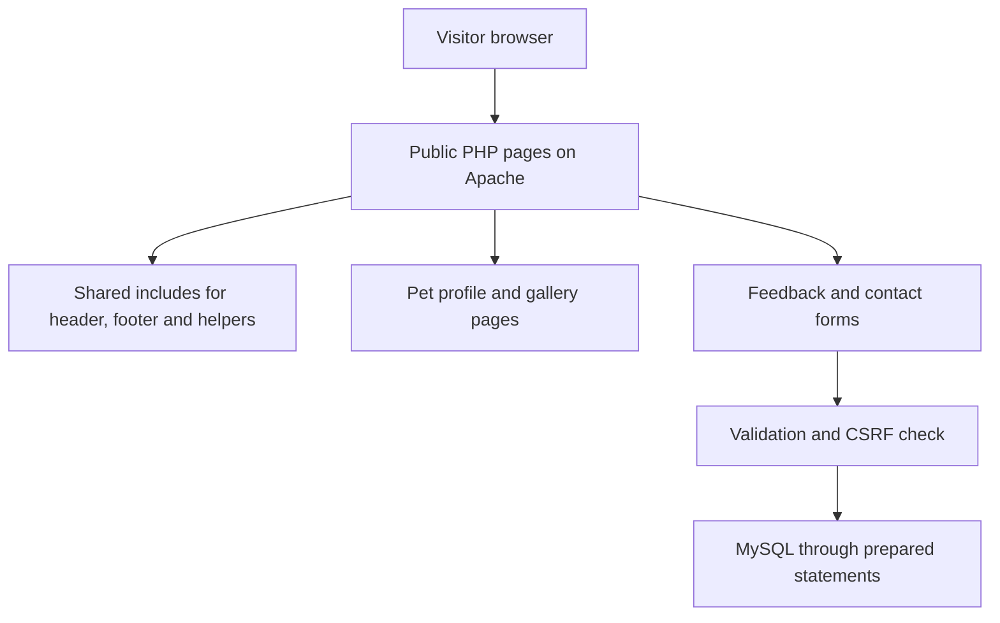

# Pet Adoption System: Animal Welfare Platform

**A web-based platform intended to connect pets in need with potential adopters.**
Built with PHP, HTML5, CSS3, MySQL / MariaDB and the XAMPP stack between March 2025 and June 2025.

> **This is a showcase repository.** The source code lives in a private repository. This page documents what the project does, how it is designed, and what I learned building it. Happy to walk through the code on request.

> Student portfolio project. The sections below separate what is built from what is planned.

[**LinkedIn**](https://linkedin.com/in/ratnesh-pathak-087466279) | [**Email**](mailto:pathakratnesh03@gmail.com)

---

## Preview

---

## Overview

Thousands of animals wait for homes, and people looking to adopt need a friendly place to meet them. This project is a website that presents adoptable pets, shares animal welfare content and collects visitor feedback, built as a first full website project on a classic PHP and MySQL stack.

## What Is Implemented

| Area | Status |
|---|---|
| Home page with image carousel and pet carousel | Implemented |
| Pet listing page and 14 individual pet profile pages | Implemented as static PHP pages |
| About page and Lost and Found photo galleries | Implemented |
| Feedback form, saved to MySQL with prepared statements | Implemented |
| Contact form, saved to MySQL with prepared statements | Implemented |

## How It Works

## Tech Stack

- **Backend:** PHP 8 with the mysqli extension
- **Database:** MySQL / MariaDB
- **Frontend:** HTML5, CSS3, JavaScript
- **Server:** Apache (XAMPP)

## Security Notes

- Parameterised queries and server-side validation on the forms
- CSRF tokens and output escaping
- No credentials in code, and errors logged instead of shown to visitors
- Configuration, include and database folders protected from direct web access
- A written security review documents the remaining limitations

## Limitations

- Pet pages are static, because pet records are not yet stored in the database
- There is no login or registration yet
- It runs locally on XAMPP and is not hosted

## Roadmap

- [ ] Pet records in the database
- [ ] Search and filtering
- [ ] Adoption application workflow
- [ ] Authenticated admin area

## Author

**Ratnesh Pathak** - M.Sc. Information Technology, AI / ML Engineer, Founder of Team Ignites

GitHub: [@RatneshPathak](https://github.com/RatneshPathak) | LinkedIn: [Ratnesh Pathak](https://linkedin.com/in/ratnesh-pathak-087466279) | Email: pathakratnesh03@gmail.com

---

(c) Ratnesh Pathak. All rights reserved. The text and images in this repository may not be reused without permission.
